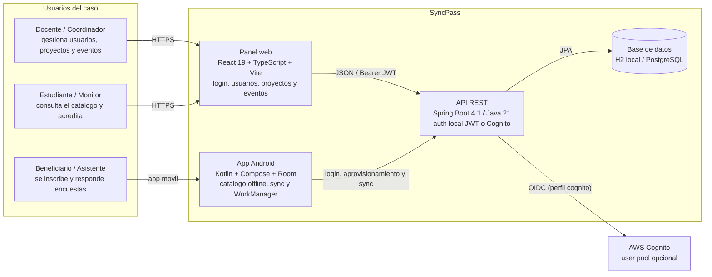
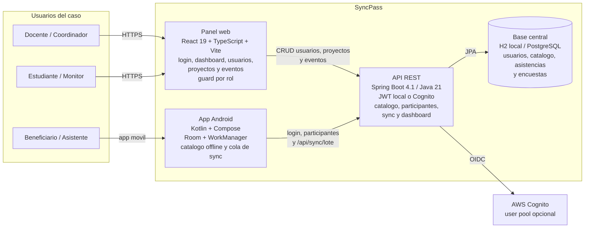
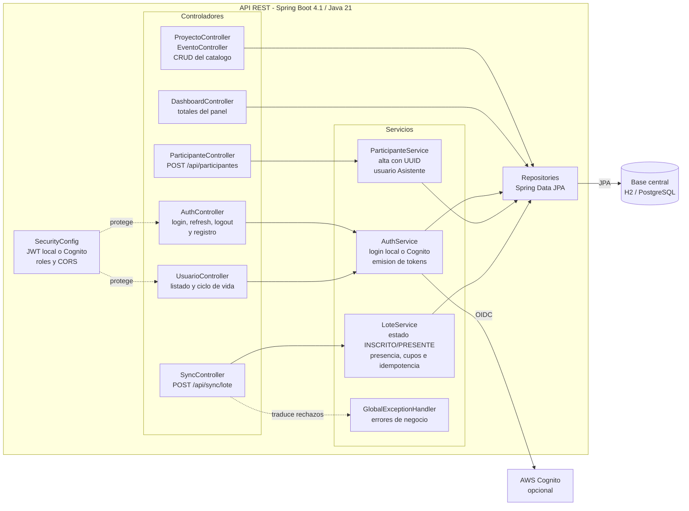

# Arquitectura — SyncPass v2

| Campo | Valor |
| --- | --- |
| Fecha | 2026-11-18 |
| Alcance | App Android, API Spring Boot, panel web React y base de datos |
| Fuente | Código de `syncpass_api`, `syncpass_web` y `SyncPassMVP` (estado `main`) |
| Diagramas | Mermaid en este documento. Los `.mmd` de `docs/diagramas/` quedan como apoyo histórico y no son fuente vigente |

## 1. Vista C1 — contexto

Tres actores usan dos clientes de la misma solución. La app opera sin red y sincroniza después; el panel web coordina y administra. La API es el único punto que accede a la base central y el único lugar donde se aplican las reglas de negocio.

## 2. Vista C2 — contenedores

| Contenedor | Tecnología | Responsabilidad |
| --- | --- | --- |
| Panel web | React 19, TypeScript, Vite, `wouter` | Login, dashboard, usuarios, proyectos y eventos. Guard de UI por rol; la autorización real la aplica la API |
| API REST | Spring Boot 4.1.1, Java 21, Spring Security, Spring Data JPA | Auth local o Cognito, catálogo, aprovisionamiento de participantes, lote de sync, dashboard y health |
| App Android | Kotlin, Jetpack Compose, Room, Retrofit, WorkManager | Login, catálogo descargado, acreditación offline, encuestas, cola de sync y reintento programado |
| Base central | H2 en memoria (`MODE=PostgreSQL`) en local; PostgreSQL por variables | Usuarios, roles, proyectos, eventos, asistencias y encuestas |

## 3. Vista C3 — componentes de la API

## 4. Autenticación y autorización

- **Modo local (por defecto):** `AUTH_MODE=local`. La API firma JWT HS256 con `JWT_SECRET`, `JWT_ISSUER` y `JWT_TTL_MINUTES` (60 por defecto). Las contraseñas se guardan con BCrypt.
- **Modo Cognito:** perfil `cognito`; la API valida tokens RS256 contra `COGNITO_ISSUER` y toma los grupos desde `cognito:groups` o `groups`.
- **Roles:** `Coordinador`, `Monitor`, `Asistente`. El rol viaja en el token y se exige con `@PreAuthorize` en los endpoints de escritura.
- **Rutas públicas:** `/api/auth/**` y `/api/health`. Todo lo demás exige `Authorization: Bearer`.
- **CORS:** orígenes configurables con `CORS_ALLOWED_ORIGINS` (por defecto `http://localhost:5173` y `http://localhost:4173`).
- **Guard del panel web:** oculta formularios y botones según el rol. No sustituye al backend: un Monitor que llame directo recibe `403`.

Detalle por endpoint en [roles-permisos.md](roles-permisos.md).

## 5. Catálogo y aprovisionamiento

**Catálogo.** Proyectos y eventos viven en la base central y se administran desde el panel web (`/api/proyectos`, `/api/eventos`). La app los descarga con `GET /api/proyectos` y `GET /api/proyectos/{id}/eventos`, y los guarda en Room con *upsert* por `remoteId`. La descarga no borra filas locales que no vengan del remoto: si un proyecto deja de estar en la API, sigue visible en el teléfono hasta que se limpie el dato local.

**Aprovisionamiento.** `POST /api/participantes` recibe `eventoId`, `usuarioUuid` y `nombre` (el correo es opcional). Si el UUID no existe, crea un usuario con rol `Asistente`, activo y **sin contraseña** (no puede iniciar sesión); si ya existe, responde `creado=false` sin duplicar ni cambiar roles. Si no se envía correo, usa `participante+<uuid>@syncpass.local`. Si el correo pedido pertenece a otro UUID, responde `409 EMAIL_EN_USO`. La app **no envía el correo del participante**.

## 6. Sincronización offline y WorkManager

**Cola local.** La app guarda asistencias y encuestas en Room con estado pendiente. La sincronización se dispara con `POST /api/sync/lote`.

**Programación.** WorkManager encola trabajo único al abrir la app, al acreditar y al responder una encuesta, y además un trabajo periódico de 15 minutos. La sincronización no depende de que el usuario recuerde tocar un botón.

**Reglas del lote** (`LoteService`, `@Transactional`):

1. Se procesan primero todas las asistencias y después todas las encuestas, porque una encuesta del mismo lote puede depender de una presencia que viaja en ese lote.
2. **Atomicidad:** cualquier rechazo lanza una excepción y la transacción completa hace rollback; no queda ninguna fila aplicada. La respuesta `409` trae `errores[]` con índice, tipo y código.
3. **Cupos:** se bloquean las filas de evento con `SELECT ... FOR UPDATE` en orden de id, y se cuentan las asistencias del evento en cualquier estado. Una fila nueva con cupo lleno se rechaza (`CUPO_LLENO`); la transición de una fila existente se permite.
4. **Estado:** `estado` ausente equivale a `PRESENTE`; `validado` se ignora y se deriva del estado. `INSCRITO → PRESENTE` actualiza la misma fila, conserva `inscritoMs` y avanza el timestamp. Si llega `INSCRITO` sobre una fila `PRESENTE`, gana `PRESENTE` y se cuenta como duplicado.
5. **Idempotencia:** la clave es `(eventoId, usuarioId)`; el UUID no participa de la clave y solo se rellena si estaba nulo. Un UUID distinto sobre una fila ya atribuida responde `CONFLICTO_IDENTIDAD`.
6. **Encuestas:** solo responde quien figura `PRESENTE`; si no, `409 SIN_PRESENCIA`. La primera encuesta gana; un reenvío cuenta como duplicado y no pisa datos.

**Rechazos.** Un `4xx` de negocio marca el ítem como rechazado y no se reintenta en bucle; la app muestra el motivo y permite descartarlo desde Ajustes. Un `5xx` o un corte de red sí se reintenta.

## 7. Modelo de datos

| Entidad | Clave | Campos relevantes |
| --- | --- | --- |
| `Usuario` | `id` (UUID en modo app; Long lógico en el contrato de asistencia) | email, nombre, roles, activo, passwordHash (nulo en participantes) |
| `Proyecto` | `proyectoId` | título, descripción, área, unidad vecinal, fechas, estado |
| `Evento` | `eventoId` | proyecto, nombre, fechaHora, cuposMax, recinto, latitud, longitud, radioMetros |
| `Asistencia` | `(eventoId, usuarioId)` | estado (`INSCRITO`/`PRESENTE`), timestamp, inscritoMs, validado, lat/lon, usuarioUuid |
| `Encuesta` | `(eventoId, usuarioId)` | satisfacción, utilidad, comentario, fecha, usuarioUuid |

## 8. Entornos

| Entorno | Cómo se activa | Base | Auth |
| --- | --- | --- | --- |
| Local | perfil por defecto `local` | H2 en memoria con `MODE=PostgreSQL`, `ddl-auto=update` | JWT HS256 local |
| PostgreSQL | `SPRING_PROFILES_ACTIVE=postgres` | PostgreSQL por `DATABASE_URL`, `DATABASE_USER`, `DATABASE_PASSWORD`; `ddl-auto=validate` | JWT HS256 local |
| Cognito | `SPRING_PROFILES_ACTIVE=cognito` (puede combinarse con `postgres`) | según perfil de base | RS256 contra issuer de Cognito |

## 9. Límites conocidos

- No hay despliegue: la API y el panel corren en el PC local.
- PostgreSQL y Cognito reales no se probaron; solo se verificó que los perfiles cargan con configuración ficticia.
- La cámara/QR físico no se verificó; el camino manual de acreditación sí.
- Las pruebas instrumentadas de Android no se ejecutaron en esta entrega.
- El panel web no administra asistencias: solo catálogo, usuarios y dashboard.

Ver comandos y números en [pruebas-cobertura.md](pruebas-cobertura.md).
