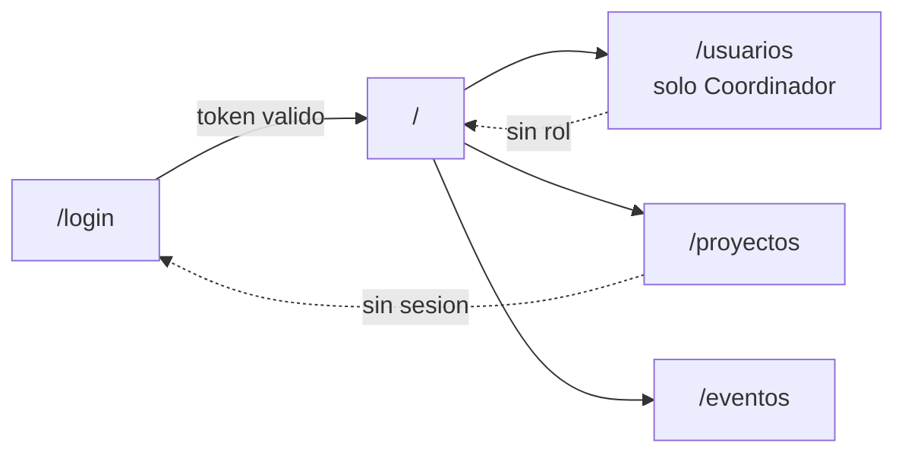
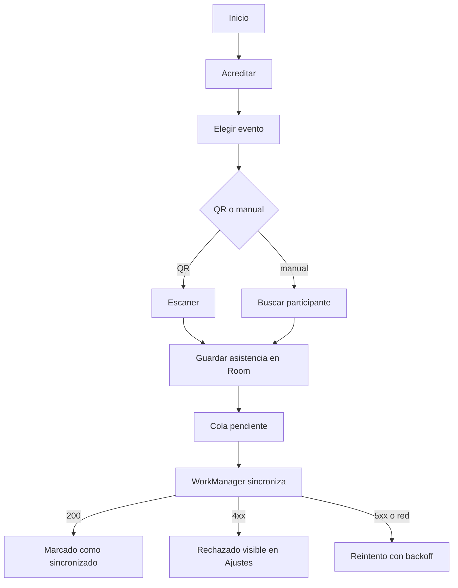

# Vistas y navegación — SyncPass v2

## 1. Panel web

Rutas definidas en `syncpass_web/src/App.tsx` con `wouter`.

| Ruta | Componente | Datos que pide | Estados visibles |
| --- | --- | --- | --- |
| `/login` | `Login` | `POST /api/auth/login` | Carga con botón deshabilitado; error del servidor; credenciales inválidas |
| `/` | `Dashboard` | `GET /api/dashboard/resumen` | Carga (`…`), error silencioso, totales |
| `/usuarios` | `Usuarios` | `GET /api/usuarios` | Carga, error, lista, alta de usuario, feedback por acción |
| `/proyectos` | `Proyectos` | `GET /api/proyectos` | Carga, error, lista vacía, formulario y acciones por rol |
| `/eventos` | `Eventos` | `GET /api/proyectos` + `GET /api/proyectos/{id}/eventos` | Sin proyectos, lista, formulario y acciones por rol |

Detalles de comportamiento:

- **Login:** muestra el mensaje del servidor (`Credenciales inválidas`, `Servidor no disponible`) y no guarda token si falla.
- **Dashboard:** si el resumen falla, deja los totales en guion y mantiene la sesión.
- **Usuarios:** Coordinador ve alta, baja, alta de nuevo y eliminación; Monitor ve solo la lista y un aviso.
- **Proyectos:** el formulario crea o edita; la lista vacía muestra un texto guía. Monitor no ve botones de escritura.
- **Eventos:** si no hay proyectos, indica que hay que crear uno antes. El evento se edita en el mismo formulario.

### Navegación y sesión

- Sin sesión, cualquier ruta redirige a `/login`.
- Con sesión, `/usuarios` redirige a `/` si el rol no es Coordinador.
- El menú (`Nav`) muestra Usuarios solo al Coordinador.
- `logout` limpia los tokens y vuelve al login.

## 2. App Android

Rutas declaradas en `SyncPassNavHost.kt` (`Routes`).

| Ruta | Pantalla | Parámetros | Rol |
| --- | --- | --- | --- |
| — | `LoginScreen` | — | Sin sesión |
| `home` | Inicio | — | Monitor |
| `accredit` | Acreditar | `eventId` opcional | Monitor y Coordinador |
| `surveys` | Encuestas | — | Monitor y Coordinador |
| `settings` | Ajustes | — | Todos |
| `projects` | Proyectos descargados | — | Monitor y Coordinador |
| `event/new` | Nuevo evento | — | Coordinador |
| `event/{eventId}` | Detalle de evento | id | Monitor y Coordinador |
| `event/{eventId}/edit` | Editar evento | id | Coordinador |
| `event/{eventId}/participant` | Agregar participante | id | Monitor y Coordinador |
| `qr/{participantId}` | QR del participante | id | Monitor y Coordinador |
| `scanner/{eventId}/{useLocation}` | Escáner | id y uso de ubicación | Monitor y Coordinador |
| `survey/{attendanceId}` | Encuesta de acreditación | id | Monitor |
| `participant_survey/{attendanceId}` | Encuesta del participante | id | Asistente |
| `survey_create` | Crear encuesta | — | Coordinador |
| `survey_take` | Tomar encuesta | — | Asistente |
| `survey_custom_answer/{surveyId}` | Responder encuesta personalizada | id | Asistente |
| `survey_custom_results/{surveyId}` | Resultados | id | Coordinador |
| `indicators/{eventId}` | Indicadores | id | Monitor y Coordinador |

### Entrada por rol

| Rol del token | Pantalla inicial |
| --- | --- |
| `MONITOR` | `SyncPassNavHost` con barra inferior: Inicio, Acreditar, Ajustes |
| `COORDINATOR` | `CoordinatorHomeScreen` |
| `PARTICIPANT` | `ParticipantHomeScreen` |

### Flujo de acreditación

### Flujo de encuesta

1. Solo aparece para quien está `PRESENTE` en el evento.
2. Se responde sin red; queda pendiente en Room.
3. Se envía en el mismo lote que las asistencias.
4. Un reenvío no duplica: cuenta como duplicado y no pisa la primera respuesta.

### Estados de interfaz en la app

- **Carga:** indicadores y listas muestran progreso mientras Room o la API responden.
- **Vacío:** catálogo sin proyectos, eventos sin participantes, encuestas sin respuestas.
- **Error de red:** se conserva lo local y se avisa; no se borra la cola.
- **Rechazo:** contador y motivo en Ajustes, con acción de descarte.

## 3. Límites de navegación

- El panel web no tiene pantalla de asistencias ni de encuestas: eso vive en la app.
- La app no tiene una vista de usuarios del backend; el aprovisionamiento es automático.
- La cámara física no se probó; el camino manual cubre la acreditación.
